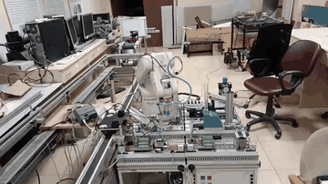
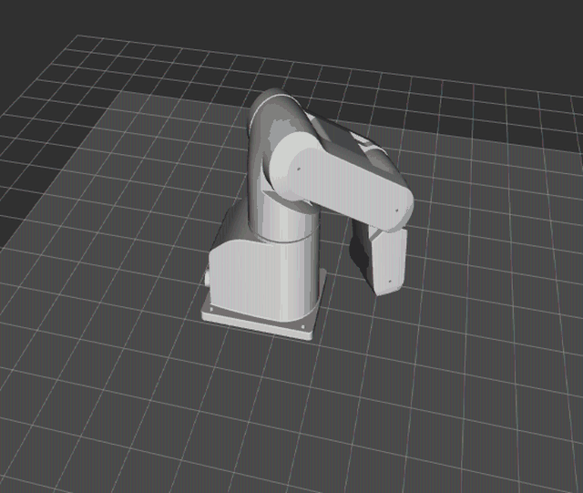
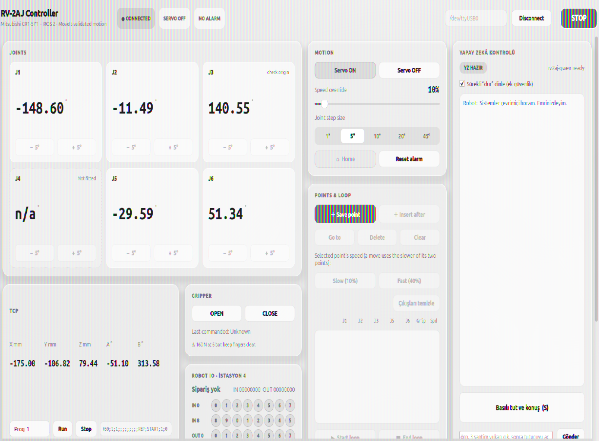
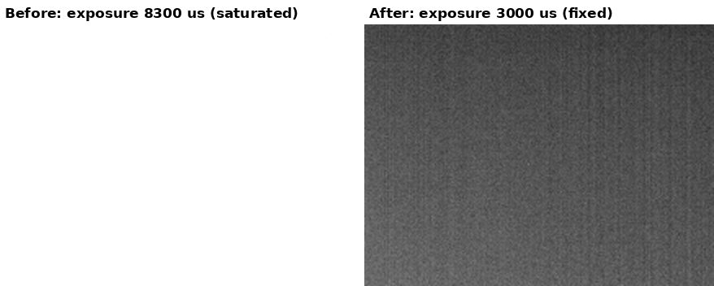

# RV-2AJ Robot Cell — Complete Project Documentation

Control software for a **Mitsubishi MELFA RV-2AJ** robot arm (controller **CR1-571**) standing on
**Station 4 of a Festo MPS 500 transfer line**, with a PyQt control panel, a ROS 2 + MoveIt motion
stack, and a fully offline, Turkish-speaking AI assistant you can talk to.

This document describes everything in the project: the hardware and how it is wired, the serial
protocol and every command that was verified on the real controller, the calibration of this
particular robot, both applications, every ROS node, topic, service and parameter, the AI
assistant and how its model was fine-tuned, the transfer-line integration, all tools and tests,
day-to-day operation, troubleshooting, safety rules, known issues and the project history.

> Last updated: 2026-10-21. (See [§19 Project history](#19-project-history) for the October 2026 work:
> per-point speed, per-point I/O actions, continuous-motion fixes, the GUI overhaul, and the
> DVT Legend 510MR and stereo-camera investigations.)

---

## Screenshots & demos

**The real RV-2AJ running the 44-point assembly** on Station 4 of the Festo MPS 500 line — the
full taught sequence (per-point speeds and gripper/I/O actions) executed by the robot over RS-232
(sped up ~19×; the full video runs about 4.5 minutes):



**The same stack in simulation / RViz** — the arm driven through a joint sweep in the ROS 2 +
MoveIt stack in simulation mode (`./start_robot.sh sim`); without `sim` it drives the real robot:



**The operator control panel** (`gui_node.py`, started with `./start_robot.sh`) — live joints,
TCP pose, Motion (servo / speed / joint step / home), Points & Loop with the per-point
**Slow/Fast** speed buttons, the Gripper card, the full **Station I/O** panel (IN/OUT groups
including the pneumatics), and the offline Turkish **AI assistant** on the right:



**DVT Legend 510MR, exposure control over the Ethernet terminal** (`dvt_legend/`) — the camera's
inspection product was saturating (all-white frames); dropping the exposure over the recovered
terminal protocol (`#PP 1 E <us>`) brought the sensor back into range. The remaining uniform grey
is because no lens is fitted — see [`dvt_legend/findings.md`](dvt_legend/findings.md):



> More images (the live robot and cell, loops running, the cameras in use) are best captured on
> the hardware — drop them in `docs/images/` and reference them here.

---

## Contents

1. [Quick start](#1-quick-start)
2. [The hardware](#2-the-hardware)
3. [Repository layout](#3-repository-layout)
4. [Serial protocol and verified commands](#4-serial-protocol-and-verified-commands)
5. [Calibration of this robot](#5-calibration-of-this-robot)
6. [ROS 2 stack (rv2aj_ws)](#6-ros-2-stack-rv2aj_ws)
7. [Motion: how a move is planned and executed](#7-motion-how-a-move-is-planned-and-executed)
8. [The control panel (GUI)](#8-the-control-panel-gui)
9. [The AI assistant](#9-the-ai-assistant)
10. [The fine-tuned model (rv2aj-qwen)](#10-the-fine-tuned-model-rv2aj-qwen)
11. [Festo MPS 500 transfer line](#11-festo-mps-500-transfer-line)
12. [The standalone MELFA GUI (melfa_gui)](#12-the-standalone-melfa-gui-melfa_gui)
13. [Tools, scripts and tests](#13-tools-scripts-and-tests)
14. [Offline operation, memory and performance](#14-offline-operation-memory-and-performance)
15. [Files the system writes](#15-files-the-system-writes)
16. [Troubleshooting](#16-troubleshooting)
17. [Safety](#17-safety)
18. [Known issues and open items](#18-known-issues-and-open-items)
19. [Project history](#19-project-history)

---

## 1. Quick start

### Start

```bash
cd ~/Desktop/RV-2AJ
./start_robot.sh norviz        # real robot, no RViz (recommended)
```

| Command | What it starts |
|---|---|
| `./start_robot.sh norviz` | real robot on `/dev/ttyUSB0`, no RViz 3-D view (saves RAM) |
| `./start_robot.sh` | real robot with RViz |
| `./start_robot.sh sim` | simulated controller, no robot needed |
| `./start_robot.sh real /dev/ttyUSB1 norviz` | real robot on another serial port |

The window opens after about 15–20 s. The terminal may be closed afterwards: the stack runs in its
own systemd scope (`rv2aj-stack`) and survives the terminal or VS Code closing.

`start_robot.sh` also:
- refuses to start in real mode if the serial port does not exist ("plug in the USB-serial adapter");
- refuses if the stack is already running;
- starts the AI model server (Ollama) in its own memory-capped systemd unit `rv2aj-ollama` if it is not already running;
- waits until systemd has fully released a previous `rv2aj-stack` scope before starting.

### Stop

```bash
./stop_robot.sh
```

Takes about 5 s. It sends SIGINT first (so the driver can send STOP, SRVOFF, CNTLOFF to the
controller), force-closes leftovers (the GUI ignores the normal stop signal), stops Ollama, and
waits until the scope is really gone so `start_robot.sh` works immediately afterwards.

### First steps after starting

1. The header shows **CONNECTED** and **NO ALARM**.
2. Press **Servo ON** (only a person can do this — the AI can never switch the servo on).
3. Move the robot: jog buttons, **Home**, points, the TCP arrow buttons, or talk to it (hold **S**).
4. Stop at any time: **`+`**, **Esc**, the red **STOP** button, saying **"dur"**, or the hardware E-stop.

### After an alarm

Press **Reset alarm**. The driver then switches the servo off and on again automatically — on this
robot the first move after an alarm reset fails otherwise.

### Logs

- Stack log: `~/.ros/rv2aj_stack.log`
- AI conversation log: `~/.ros/rv2aj_ai_log.txt`

---

## 2. The hardware

### 2.1 Robot arm — Mitsubishi MELFA RV-2AJ

- 5-axis vertical articulated arm. Joints: **J1** base/waist rotation, **J2** shoulder, **J3** elbow,
  **J5** wrist pitch (tilt), **J6** wrist roll. **There is no J4** (the controller reports it as `****`).
  With 5 axes the tool can pitch and roll but cannot yaw sideways, so some orientations are impossible.
- Geometry (manual BFP-A8050, Fig. 2-5; confirmed against the controller's own positions to < 0.05 mm):
  - shoulder (J2) axis **300 mm** above the mounting face,
  - upper arm **250 mm**, forearm **160 mm**,
  - J5 axis to flange face **72 mm**, no lateral offsets.
- Catalogue values (not verified on this unit): 2 kg payload, ~410 mm reach, ±0.02 mm repeatability, ~17 kg.
- AC servo motors, absolute encoders backed by batteries. If the batteries run low the origin is lost
  (controller error 5150 "The origin has not been set", every EXEC command is then refused).
- The base is mounted turned 180° relative to the manual's drawing: at home the arm reaches away
  from the cable connectors. The URDF base mesh has a 180° yaw for this.

### 2.2 Controller — CR1-571

- Language MELFA-BASIC IV. Commands can be executed directly over the RS-232 port ("EXEC" commands).
- Its own joint limits (parameter **MEJAR**, set on the teach pendant) are the final authority; they
  are not readable over serial. The operator has widened them.
- Standard I/O on the 50-pin CN100 connector (card RZ386/RZ387). Outputs need an external 12/24 V supply.
  Factory-dedicated signals: OUT0 running, OUT1 servo on, OUT2 error, OUT3 operation rights;
  IN0 STOP (fixed), IN1 servo off, IN2 error reset, IN3 start, IN4 servo on, IN5 operation rights.

### 2.3 Gripper — Festo HGP-16

- Pneumatic parallel gripper, up to 160 N at 6 bar. Air hoses run around the wrist (watch them
  when J6 turns a lot).
- Commanded with the controller's hand commands `EXECHOPEN 1` / `EXECHCLOSE 1` (accepted with QoK;
  physical jaw motion was observed by the operator). The AI waits 0.5 s after closing so the part settles.

### 2.4 The cell

- The robot stands on the Station 4 table of a **Festo MPS 500** transfer line ("Robot with assembly").
- Around the base: a blue block in front, a chute and pneumatic parts on the right, conveyor rails
  around the back. **These stick up above the table surface and are not in the collision model**
  (only the flat table is) — keep watching moves near them.
- The station is connected with a 24-pin SysLink cable at connector **XPA4** (see section 11).

### 2.5 PC and link

- Laptop: Ryzen 5 6600, **RTX 3050 Laptop 4 GB**, **7 GB RAM** (VS Code alone uses ~3 GB), Ubuntu 24.04, ROS 2 Jazzy.
- Serial: **FTDI FT232 USB-serial adapter** → `/dev/ttyUSB0`, **9600 baud, 8 data bits, even parity, 2 stop bits (8E2)**.
  The user must be in the `dialout` group (they are).
- The adapter has dropped off the bus a few times; the very first open after plugging it in once
  returned ~40 KB of garbage (the next open was clean).

---

## 3. Repository layout

```
~/Desktop/RV-2AJ/
├── README.md                  this file
├── start_robot.sh             start everything (see 1.)
├── stop_robot.sh              stop everything
├── rv2aj_ws/                  ROS 2 workspace (the main system)
│   └── src/
│       ├── rv2aj_description/     URDF/xacro, meshes, config/joint_limits.yaml (limits, calibration)
│       ├── rv2aj_moveit_config/   MoveIt config: SRDF (home, collisions), moveit.launch.py, RViz config
│       ├── rv2aj_interfaces/      custom messages, services, actions
│       └── rv2aj_control/         all nodes, config, AI, fine-tuning, tests
│           ├── rv2aj_control/     Python package (nodes + libraries)
│           ├── config/            rv2aj.yaml, ai_examples.json, ai_knowledge.txt
│           ├── launch/            bringup.launch.py
│           ├── finetune/          dataset generator, training, merge, build, evaluation
│           └── test/              pytest tests, AI evaluations, joint-limit probe
├── melfa_gui/                 standalone PyQt control panel (first application, no ROS)
├── melfa_*.py, festo_io_session.py   one-off hardware exploration tools (section 13)
├── output_map.txt, festo_io_session.txt   results of the I/O exploration
├── stereo_view.py             stereo USB camera: live view, depth heatmap, YOLO + palm distance
├── dvt_legend/                DVT Legend 510MR smart-camera investigation (scripts, findings.md,
│                              protocol.md, modbus_map.md; large binaries/vendor installer gitignored)
└── points_backups/            exported teach-point backups (joints, speeds, gripper, I/O)
```

> Note: build artifacts (`rv2aj_ws/build|install|log`), the fine-tuned model blobs (`*.gguf`,
> `*.safetensors`), the DVT vendor installer and its 165 MB of carved binaries, calibration
> images and raw camera captures are **gitignored** — they are regenerated by the scripts here
> (`finetune/`, `dvt_legend/*.py`) or downloaded separately. See `.gitignore`.

Outside the project:
- `~/rv2aj_ft/` — fine-tuning work directory (LoRA adapter, llama.cpp tools, logs).
- `~/.local/ollama/` — per-user Ollama installation (no sudo).
- `~/.local/share/piper-voices/` — offline voices.
- `~/.ros/` — runtime files (points, logs, AI memory; section 15).

---

## 4. Serial protocol and verified commands

### 4.1 Framing

- Every command is sent as `1;1;<COMMAND>\r`.
- Replies end with `\r`. A reply starting with **`Qo`** means OK, **`Qe`** / **`Qx`** means error.
- A **lowercase** status letter (`Qok`, `Qer`) means an alarm is pending; `RSTALRM` clears it.
- Error replies encode the error number: `QeR422000000` → error 4220. `ERRORMES<n>` returns its text.

### 4.2 Read-only queries (used by the poll loop)

| Command | Reply example | Meaning |
|---|---|---|
| `STATE` | `QoK1.MB4;10;100;4;01060;1;1;;;;;;;;;REP;START;1;0` | program, line, **override %**, …, **last error field** |
| `JPOSF` | `QoKJ1;-149.72;J2;-64.62;J3;137.13;J4;****;J5;-92.73;J6;-72.67;...` | joint angles (J4 `****`) |
| `PPOSF` | `QoKX;84.78;Y;49.46;Z;522.81;A;-221.18;B;-20.22;...` | tool position in the controller's frame |
| `VALM_INB(0)` / `VALM_OUTB(0)` | `QoKM_INB=+16` | I/O byte 0 (bits 0–7) |
| `VALM_IN(n)` / `VALM_OUT(n)` | `QoKM_OUT(4)=+0` | single input/output |
| `VALM_ERR`, `VALM_ERRNO`, `VALM_ERRLVL` | `QoKM_ERRNO=+0` | active error state |
| `VALJTMP`, `VALPTMP` | `QoKJTMP=(-156.60,-6.49,+145.55,+0.00,-34.60,+61.33)` | read back a variable |
| `ERRORMES<n>` | `QoKEncoder communication error` | error text |

**Important — reading `STATE`:** its 5th field (`01060`, `A1060`, `81062000`…) contains the **last
recorded** error, not necessarily an active one. An active joint-range alarm appears as
**`81069x`** where **x is the axis** (`8106961` = J1, `…62` J2, `…63` J3, `…65` J5). Use
`VALM_ERR` / `VALM_ERRNO` to know whether an error is active. (Misreading this once led to a
wrong "J5 encoder fault" diagnosis — see section 19.)

### 4.3 State-changing commands (verified)

| Purpose | Commands |
|---|---|
| Operation rights | `CNTLON` / `CNTLOFF` (needed before EXEC commands; otherwise error 6020 "The Operation is disable") |
| Servo | `SRVON` / `SRVOFF` |
| Stop | `STOP` (halts an EXECMOV mid-move) |
| Reset alarm | `RSTALRM` |
| Speed override | `EXECJOVRD <1-100>` (needs CNTLON) |
| **Relative joint move** | `EXECJTMP=J_CURR`, `EXECJTMP.J<n>=JTMP.J<n>+RAD(<deg>)`, `VALJTMP` (check), `EXECMOV JTMP` |
| **Absolute joint move** | same as above, one `+RAD(target-current)` edit per joint (see below) |
| **Straight TCP move** | `EXECPTMP=P_CURR`, `EXECPTMP.Z=PTMP.Z+5.00`, `VALPTMP`, `EXECMOV PTMP` |
| Gripper | `EXECHOPEN 1` / `EXECHCLOSE 1` |
| Outputs | `EXECM_OUT(n)=0/1` (after CNTLON; read back to confirm) |
| Continuous path | `EXECCNT 1` / `EXECCNT 0` (accepted) |

Behaviour notes:
- `EXECMOV` replies `QoK` immediately; the motion continues afterwards, so the driver polls `JPOSF` until settled.
- **A new EXECMOV while a move is running is refused**: error **5640 "Cannot execute during RUN"** — with or
  without `CNT 1`. Moves sent over serial cannot be blended; every move stops before the next one.
- Tuple expressions are **not** accepted: `J_CURR+(...)` gives **L4220 syntax error**. The absolute tuple form
  `JTMP=(j1,...,j6)` was never confirmed, so absolute moves are built only from the verified component edits.
  The simulator rejects any tuple form so this can never creep back in.
- Every move is read back with `VAL…` and checked before `EXECMOV`; a mismatch refuses the move.
- `OPEN` always returns `QeR601` but is harmless.

### 4.4 Error numbers seen on this robot

| Error | Text | Meaning here |
|---|---|---|
| 0965 | Excessive error 1 | servo could not follow |
| 1060 / 1069 | Encoder communication error | appeared as the stale "last error" in STATE |
| 1120 | Encoder ABS position data lost | origin data lost (batteries) |
| 4220 | Syntax error | e.g. `J_CURR+(...)` |
| 5150 | The origin has not been set | origin lost — all EXEC commands refused |
| 5600 | Cannot execute during an error | reset the alarm first |
| 5640 | Cannot execute during RUN | a move is still running |
| 6010 | Illegal command | |
| 6020 | The Operation is disable | CNTLON missing |
| `81069x` in STATE | joint range limit on axis x | controller limit (MEJAR) reached |

### 4.5 Robot quirk

After any alarm reset, **the next move fails** unless the servo is switched **off and on** again.
The driver's `reset_alarm` does this automatically; the limit probe does it too.

---

## 5. Calibration of this robot

All robot-specific numbers live in **one file**:
`rv2aj_ws/src/rv2aj_description/config/joint_limits.yaml`. It is read by the URDF (MoveIt),
the kinematics library (planner, AI validator, driver) and the GUI. After editing it, rebuild
(`colcon build --packages-select rv2aj_description rv2aj_control`) and restart.

### 5.1 Origin and zero offsets

On 2026-09-28 the operator re-set the controller's origin. The new zeros are **not** the real
"arm straight up" pose, so the controller's own X/Y/Z (and our model, which agreed with it)
was wrong: a "horizontal" circle came out vertical.

Fix (software calibration, the operator's choice): the arm was jogged **straight up** (upper arm,
forearm and wrist in one vertical line) and the readings were stored:

```yaml
zero_offsets_deg: {J2: -90.3, J3: 66.16, J5: -173.11}
```

Everything geometric uses `reading − offset`:
- `kinematics.fk()` / `ik()` (planner, AI validator, shapes),
- the URDF joint origins (turned by −offset, so MoveIt's model and the table check match reality),
- the tool position shown in the GUI (computed from the corrected model instead of the controller's `PPOSF`),
- the joint-limit probe's table guard.

Check: with the offsets, the arm straight up computes to **X 0, Y 0, Z 782 mm** (300+250+160+72), and the
measured joint ranges minus the offsets match the manual (J3 −110.9…115.4, J5 −100.9…91.1, J2 −61.7…93).

Consequences:
- The controller's own Cartesian moves (`EXECMOV PTMP`) and circular moves (`MVC`) use the uncorrected
  frame, so the driver **refuses its direct TCP move** while calibrated; all straight moves go through the
  corrected planner instead.
- **J1's zero is not calibrated** (it does not affect up/down or flatness, but it decides which way
  "left/right" point). Check "2 santim sola git" goes left.
- The clean long-term fix is to redo the origin on the pendant with the **origin data** method (factory
  codes from the origin data sheet: `MENU → ORIGIN/BRK → ORIGIN → DATA`, see BFP-A8050 "Setting the origin").
  Then the controller's own frame is right, smooth `MVC`/`MVR` circles become possible, and the offsets can be set back to 0.

### 5.2 Measured joint limits (2026-09-28)

Measured on the real robot with `test/probe_joint_limits.py` (5° steps at 5 % speed until the controller
alarmed), limits set about 2° inside the alarm points. Values are controller readings.

| Joint | Alarm points (measured) | Limit set | Notes |
|---|---|---|---|
| J1 | −329.7 / −19.5 | **−327.5 … −21.5** | + end repeated twice at −19.46 |
| J2 | −152 (table) / +2.7 | **−150 … +0.5** | − side stopped by the table guard, not the controller |
| J3 | −44.7 / +181.6 | **−43 … +210** | raised 2026-10-16 (operator): controller MEJAR found wide open (±1800°), arm jogged to 194.41 |
| J5 | −274 / −82.0 | **−272 … −84** | ~192° span; the + end at −82 is where it "refused to move up" |
| J6 | none in −425 … +339 | **−425 … +335** | tested range; the operator confirmed it is fine |

The same ranges are used by the AI (`joint_limits_deg` in `rv2aj.yaml`, `DEFAULT_LIMITS` in `ai_brain.py`).
Rule everywhere: a joint already outside its range may stay or move back in, never further out.

### 5.3 Home pose

The operator's home (controller readings), saved in `rv2aj.yaml` (sequencer and AI), the node
defaults and the SRDF group state `home`:

| J1 | J2 | J3 | J4 | J5 | J6 |
|---|---|---|---|---|---|
| −118.49 | −101.71 | 186.64 | — | −127.75 | −279.42 |

Old points taught before the origin reset were backed up to
`~/.ros/rv2aj_points_before_origin_reset_2026-09-28.json` and cleared; re-teach the points you need.

### 5.4 Table and gripper in the model

The URDF contains:
- **`table`** — a 1.4 × 1.4 m slab whose top is the base mounting plane (Z = 0).
- **`gripper_envelope`** — collision-only box 80 × 80 mm, 120 mm out from the flange face.

MoveIt (`/check_state_validity`) refuses any pose where the arm or the gripper touches the table
(verified: "wrist into the table" and "fingers into the table" are refused, the same poses 10 cm higher are allowed).
Other station parts are **not** modelled.

### 5.5 Frozen joints (for a real hardware fault)

```yaml
frozen_joints: []          # e.g. [J5]
```

A frozen joint never moves: straight-line moves keep it and let the tool pitch change instead,
joint targets (home, points, AI) keep its current angle, OMPL detours are constrained, RViz trajectories
that move it are refused, the driver refuses steps and overrides targets, the AI answers that the joint is
locked, and the GUI card shows "LOCKED · encoder fault". Currently empty.

---

## 6. ROS 2 stack (rv2aj_ws)

### 6.1 Packages

| Package | Content |
|---|---|
| `rv2aj_description` | `urdf/rv2aj.urdf.xacro` (links, joints, limits from `joint_limits.yaml`, zero offsets, table, gripper envelope), meshes |
| `rv2aj_moveit_config` | `config/rv2aj.srdf` (group `arm` base_link→tool0, home state, disabled collision pairs), `launch/moveit.launch.py`, `config/moveit.rviz` |
| `rv2aj_interfaces` | messages, services, actions (6.4) |
| `rv2aj_control` | nodes (6.2), libraries (6.5), config, launch, fine-tuning, tests |

Build:
```bash
cd ~/Desktop/RV-2AJ/rv2aj_ws && source /opt/ros/jazzy/setup.bash
colcon build && source install/setup.bash
```

### 6.2 Nodes (namespace `/rv2aj`)

| Node | Role |
|---|---|
| **driver** | Owns the serial port. Polls JPOSF every cycle (~0.1 s per query), STATE+PPOSF every 1 s (0.5 s while moving) and the line I/O bytes. Executes moves, gripper, outputs, servo, override. Publishes `status` and `joint_states`. Uses the simulated controller (`fake_link`) when `use_fake_hardware` is true. |
| **planner** | MoveIt-validated motion in front of the driver: `planned/tcp_move`, `planned/joint_move`; also MoveIt's trajectory controller (RViz "Plan & Execute"). |
| **jog** | RViz interactive marker (X/Y/Z arrows at the TCP): drag and release makes one straight, validated move. |
| **sequencer** | Teach points, loop playback, home. |
| **translator** | Simple English voice/text phrases → commands ("move up 20", "go to point 2", "stop"). |
| **voice** | Legacy microphone → Google speech recognition → `voice/text` (off by default; the start script launches with `voice:=false`). |
| **ai** | The AI assistant (section 9). |
| **gui** | The control panel (section 8). |
| move_group, robot_state_publisher, rviz2 | MoveIt (root namespace), following `/rv2aj/joint_states`. |

### 6.3 Launch

`ros2 launch rv2aj_control bringup.launch.py` with arguments:

| Argument | Default | Meaning |
|---|---|---|
| `use_fake_hardware` | false | simulate the controller |
| `port` | /dev/ttyUSB0 | serial port |
| `use_moveit` | true | route moves through the planner (MoveIt validation) |
| `rviz` | true | RViz window |
| `gui` | true | control panel |
| `voice` | true | legacy voice node (start script sets false) |
| `points_file` | auto | real: `~/.ros/rv2aj_points.json`, sim: `~/.ros/rv2aj_sim/points.json` |
| `ai` | true | AI node |

The simulator uses its own points and AI memory (`~/.ros/rv2aj_sim/`), seeded from the real points
on first run, so testing never writes into the real robot's files. GUI processes get the snap GTK
variables stripped (VS Code snap terminals crash PyQt otherwise).

### 6.4 Interfaces

**Topics**
- `/rv2aj/status` (`RobotStatus`): connected, servo_on, alarm, moving, active_motion, override_percent,
  joints_deg[6], x/y/z_mm, a/b_deg, state_raw, last_error, gripper, line_inputs, line_outputs.
- `/rv2aj/joint_states`, `/rv2aj/sequencer/status` (latched), `/rv2aj/planner/robot_commands`,
  `/rv2aj/voice/text`, `/rv2aj/voice/command`, `/rv2aj/ai/request`, `/rv2aj/ai/state` (latched JSON),
  `/rv2aj/ai/path_preview` (RViz marker).

**Services (driver)**: `connect` (Connect: port), `disconnect`, `servo` (SetBool), `stop`, `reset_alarm`,
`set_override` (SetOverride: percent), `run_program` (RunProgram — **RUN is untested**), `gripper/open`,
`gripper/close`, `line/set` (LineSignal: signal ready|busy|error_code|sim_order, value).

**Services (sequencer)**: `points/save` (SavePoint), `points/delete`, `points/goto` (PointName),
`points/clear`, `loop/start`, `loop/stop`, `home/goto`.

**Services (ai)**: `ai/confirm`, `ai/cancel`. **Voice**: `voice/enable` (SetBool).

**Actions**: `tcp_move` / `joint_move` (driver, direct), `planned/tcp_move` / `planned/joint_move`
(planner), `/rv2aj_arm_controller/follow_joint_trajectory` (planner, for MoveIt).
- `TcpMove`: axis `X|Y|Z|R|V…`, distance_mm (R = along the arm's reach; V = vector jog pieces).
- `JointMove`: `relative` + `joint` + `offset_deg`, or absolute `target_deg[6]`; result success, message, final_deg.

Examples:
```bash
ros2 topic echo --once /rv2aj/status
ros2 service call /rv2aj/servo std_srvs/srv/SetBool "{data: true}"
ros2 action send_goal /rv2aj/planned/tcp_move rv2aj_interfaces/action/TcpMove "{axis: Z, distance_mm: 10.0}"
ros2 action send_goal /rv2aj/joint_move rv2aj_interfaces/action/JointMove "{relative: true, joint: J1, offset_deg: 5.0}"
ros2 topic pub --once /rv2aj/ai/request std_msgs/String "{data: '3 santim yukarı çık'}"
```

### 6.5 Libraries (rv2aj_control/rv2aj_control)

| File | Content |
|---|---|
| `serial_link.py` | port handling, framing, verified command sequences, reply parsers, transfer-line helpers |
| `fake_link.py` | wire-level controller simulator (parses the real command strings; rejects tuple forms) |
| `driver_core.py` | driver logic: worker thread, polling, motion tracking/settling, safety shutdown |
| `kinematics.py` | exact 5-axis FK/IK, straight lines, limits, frozen joints, zero offsets |
| `voice_commands.py` | the translator's phrase parser |
| `ai_brain.py` | AI vocabulary, validator, intent guards, repairs, follow-ups, prompts, Ollama client |
| `ai_speech.py` | recorder, Whisper transcriber (GPU/CPU), hallucination filter |
| `ai_stop_listener.py` | always-on Vosk "dur" listener |
| `ai_voice_fx.py` | interface sounds, voice helpers |
| `widgets.py` | GUI widgets and theme |

### 6.6 Configuration — `config/rv2aj.yaml`

- **driver**: port, auto_connect (starts only the read-only poll), default_override_percent 10 (applied on every
  connect), max_tcp_move_mm 50, max_joint_step_deg 45, poll intervals.
- **planner**: check_step_deg 1, line_step_mm 5, line_tolerance_mm 1, planning_time_s 5, move caps.
- **translator**: require_keyword, default/max distance.
- **sequencer**: points_file, **home_joints_deg**, **home_speed_percent** 40 (Home's speed for the
  slowest-of-two rule; Home has no taught speed of its own), gripper_wait_s 0.6.
- **ai**: model `rv2aj-qwen`, ollama_url, k_examples, **confirm_mode** (`guesses`|`all`), plan_ttl_s 120,
  speak, tts `piper`, voice_tr/voice_en, language `tr`, voice_style `plain`, sounds, memory/log files,
  **joint_limits_deg**, home fallback.
- **gui**: whisper_model `small`, whisper_language `tr`, stop_listener true.

---

## 7. Motion: how a move is planned and executed

1. **Request** — a GUI button, the AI, the sequencer, the translator or RViz asks the planner
   (`planned/…`) for a move.
2. **Planning**
   - *Straight TCP move*: exact 5-axis IK every 5 mm along the line, keeping the tool pitch and J6 (as the
     controller would), then the fewest waypoints that stay within 1 mm of the true line. A singularity
     (joint jump > 30° between samples) refuses the move.
   - *Joint move*: the direct joint-space line if MoveIt finds it collision-free, otherwise an OMPL plan,
     shortcut to the fewest valid waypoints.
3. **Validation** — every waypoint and the path between them (at least every 1°) goes through MoveIt
   `/check_state_validity` (self-collision, table, gripper envelope) and the joint limits.
4. **Execution** — the driver runs each waypoint as an absolute joint move (`EXECMOV JTMP`, a straight
   line in joint space — exactly the validated path), polling JPOSF until it settles
   (reached = at target and still for 0.2 s; stopped = still for 1 s away from target; timeout 120 s).
5. **Result** — reached / stopped short (with the angles) / refused (with the reason).

Caps: one TCP move ≤ 50 mm at the driver (the AI splits longer moves), one joint step ≤ 45°.

**Shapes** (square, rectangle, circle, arc) are drawn from the current TCP as many short straight pieces
(≤ 45 mm; curves ~1 cm), so the robot **stops briefly between pieces** — smooth circular interpolation is
not possible over serial (section 4.3). The validator mirrors, repositions or scales a shape so it fits.

**Speed**: the driver sends the override with every move (default 10 %, the AI may use up to 30 %).
The controller's own override reads 100 %; programs run from the pendant would use that.

---

## 8. The control panel (GUI)

Header: connection state, servo, alarm pills; port box; Connect/Disconnect; **STOP**.

| Area | What it does |
|---|---|
| **Joints** | one card per joint: live angle, −/+ step buttons (step size 1/5/10/20/45°), hints ("check origin", "Not fitted" for J4, "LOCKED" for frozen joints). Steps go through the planner (limits + MoveIt). |
| **TCP** | X/Y/Z/A/B of the tool (corrected model when calibrated), program row (Prog number, Run, Stop, STATE reply — RUN untested), distance per move (5/10/20/50 mm), Up/Down/Left/Right/Forward/Back buttons, legacy voice toggle. |
| **Gripper** | OPEN / CLOSE, last commanded state, 160 N warning. |
| **Robot IO · İstasyon 4** | live LEDs for every I/O group in use (survey 2026-10-16, `io_survey_2026-10-16.txt`): IN0–7, IN8–15, OUT0–7, OUT8–15, hand inputs 900–907 (EL G) and hand outputs 900–907 (EL Ç; the pneumatic valves, 900/901 = gripper hand 1). Every output is clickable (driver `line/set` signal `out<n>`, n = 0–15 or 900–907; one bit written, its byte read back). Current order from IN7/IN6, Hazır/Meşgul toggles, error code 0–3, and "Genel çıkışları sıfırla" (OUT0–15 only; hand valves are left alone so cylinders don't jump). The extra bytes are polled only while the arm is idle. At the survey: IN4, IN9, IN11, IN13, IN15 on; hand outputs 901, 902, 904, 906 on (one side of each valve pair). **"📍 Tıklananı seçili noktaya kaydet"** (operator's choice, 2026-10-20): while checked, clicking an output also records it (output + value) against the selected point, same slot as the gripper — set automatically after the robot arrives there. |
| **Motion** | Servo ON/OFF, speed override slider, joint step size, Home, Reset alarm. |
| **Points & Loop** | Save point, **Insert after** (teach a point between two existing ones), Go to, Delete, Clear, table of points (joints, gripper, **speed %**), Start/End loop. **Slow (10%) / Fast (40%)** set the selected point's own speed override (operator's choice, 2026-10-20; see below). A summary line shows the selected point's recorded IO actions with a **"Çıkışları temizle"** button to remove them all. |
| **Event log** | everything the stack does. |
| **Yapay Zekâ Kontrolü** | the AI chat (section 9.7). |

**Keyboard**
- **`+`** (main or numpad): emergency stop, always — even while typing in a field (so "+" cannot be typed in the chat).
- **Esc**: stop.
- **Hold `S`**: push-to-talk (not while typing in a text field; releasing or leaving the window sends).

---

## 9. The AI assistant

A Turkish-speaking assistant ("hocam") that chats, answers questions about the robot and the cell, and
controls the arm. Everything runs **offline** on the laptop.

### 9.1 Pipeline

```
hold S / 🎙 button ─▶ microphone ─▶ Whisper small (GPU, ~0.2 s) ─▶ silence/hallucination filter
      typed text ─────────────────────────────────────────────────────────┐
                                                                        ▼
             raw text: "dur" / "stop" words ─▶ STOP immediately (never through the model)
                                                                        ▼
            transcript fixes ("bir razı"→"biraz", "illeri"→"ileri", "gitti"→"git", …)
                                                                        ▼
   rule follow-ups (daha / tekrar / geri al / büyüt / küçült) ── or ── rv2aj-qwen (Ollama, ~0.5 s)
                                                                        ▼
        repairs (wrong number / opposite direction) ─▶ VALIDATOR (limits, reach, table, rules)
                                                                        ▼
        intent guards (does the plan fit the words?) ─▶ run now │ ask "doğru mu?" │ refuse (safety only)
                                                                        ▼
                 execute through the planner ─▶ report ─▶ Piper voice (community Turkish, ~0.3 s)
```

Total from releasing the talk button to hearing the answer: ~1–1.2 s.

### 9.2 Command vocabulary (what the model produces)

`WHERE`, `STATUS`, `LIST_POINTS`, `LIST_SKILLS`, `LINE_STATUS`, `SERVO_OFF`, `WAIT <s ≤ 10>`,
`GRIPPER OPEN|CLOSE`, `SPEED <1-30>`, `MOVE_TCP UP|DOWN|LEFT|RIGHT|FORWARD|BACK <mm ≤ 200>`,
`MOVE_JOINT_REL J<n> <±deg ≤ 90>`, `TILT_WRIST UP|DOWN <deg>`, `MOVE_JOINT_ABS J<n>=<deg> …`,
`GOTO_POINT <name>`, `GO_HOME`, `SAVE_POINT <name>`, `DRAW_SQUARE <mm> [VERTICAL]`,
`DRAW_RECTANGLE <w> <h> [VERTICAL]`, `DRAW_CIRCLE <diameter> [VERTICAL]`,
`DRAW_ARC <radius> <deg> LEFT|RIGHT [VERTICAL]`, `LINE_READY ON|OFF`, `LINE_BUSY ON|OFF`,
`LINE_ERROR_CODE <0-3>`, `RUN_SKILL <name>`, `DEFINE_SKILL <name>: <cmd> | <cmd>`, `FORGET_SKILL <name>`.
Typing `> COMMAND, COMMAND` in the chat sends commands directly (no model).

### 9.3 Validator (ai_brain.validate)

- Simulates every step with the kinematics (with the calibration) and **clamps** motion at the limits instead of
  refusing ("sınır nedeniyle 5 santim yerine 4 milimetre"); a joint outside its range may only move back in.
- Finds **manoeuvres** when a straight line is blocked (other wrist pitch, joint move to the exact target).
- Shapes: mirrors, moves to where the whole shape fits, or scales it down; never distorts it.
- Hard refusals: servo ON (never), OUT0–OUT3, speed > 30, waits > 10 s, unknown points/skills, J4, frozen joints.

### 9.4 Intent guards and repairs

Deterministic checks that the plan matches the operator's words — numbers, units (cm × 10), directions,
joints, names, shapes. They **never refuse a safe plan for wording**:
- **Repair** obvious slips: the operator said one amount with a unit and the model wrote another
  ("5 cm sola" → LEFT 50), or the model wrote the opposite of the one direction said.
- **Follow-ups by rule** from the last plan shown: "daha", "biraz daha", "2 santim daha", "tekrar",
  "bir daha", "geri al", "büyüt", "küçült", "daha büyük".
- **Re-think once** when a plan has nothing in common with the request, or a read nobody asked for.
- Otherwise **ask**: "Tam olarak böyle demediniz hocam, ben şöyle anladım … Doğru mu?"
- Questions: commands the words do not ask for are dropped and only the answer is kept.
- Fuzzy matching for speech-recognition typos (not for real words, e.g. "ileri" is never read as "içeri");
  Turkish letters dropped by Whisper ("bes bucuk", "basa don") are understood.

### 9.5 Confirmation (`confirm_mode`)

- **`guesses`** (current, the operator's choice): clear commands run immediately; guesses, auto-corrected plans and
  motions with the servo off wait for **Onayla** or a spoken "evet"/"onayla" ("iptal"/"hayır" cancels).
  A misheard word can therefore move the arm — keep a stop within reach.
- **`all`**: every motion waits for confirmation. Set in `rv2aj.yaml`.

### 9.6 Knowledge, memory and skills

- **`config/ai_knowledge.txt`** — a fact sheet (robot, controller, gripper, cell and I/O, software, limits, safety,
  coordinates, home). It is given to the model only for questions and small talk. **Edit it to correct or add facts;
  no retraining needed.**
- **Learned examples** (`~/.ros/rv2aj_ai_memory.json`): confirmed plans become hints; `teach: <phrase> => <cmd>, <cmd>`
  teaches an exact phrase.
- **Skills**: "selam adında bir beceri öğren: bileği 30 derece döndür, sonra geri döndür", then "selam yap".
- **Honesty**: position/status questions are always answered from a real reading (WHERE/STATUS); a reply that invents
  numbers is discarded. Rejected plans are removed from the conversation history.
- **Seed examples**: `config/ai_examples.json` (~160 hand-written Turkish/English request → command pairs) — used as
  few-shot examples by the older non-fine-tuned models (qwen3:4b, qwen2.5:3b) and as recall hints.
- **Conversation memory**: the last exchanges (up to 15 minutes, `history_ttl_s` 900) are shown to the model, together
  with notes about what the robot really did, so "neden?" / "ne oldu?" get true answers.
- **Plan expiry**: a plan waiting for confirmation expires after 120 s (`plan_ttl_s`).
- **Path preview**: every motion plan is drawn in RViz as a line (`/rv2aj/ai/path_preview`, frame `base_link`):
  orange while waiting, green when done (add the "AI path preview" Marker display; the provided `moveit.rviz` has it).
- **The AI log** (`~/.ros/rv2aj_ai_log.txt`) records every step with a tag: REQUEST, FIXED_TEXT, FOLLOWUP, RECALL,
  LLM_OUTPUT, REPAIRED, VALIDATOR, UNCERTAIN, REPLAN, DROPPED_WAIT, DROPPED_ON_QUESTION, EXECUTE, STEP_DONE,
  EXEC_ERROR, RESPONSE, CONFIRM, CANCEL, EMERGENCY_STOP, TAUGHT.

### 9.7 The AI panel

Chat (Siz / Robot) with an animated **"typing" bubble**: "dinliyorum" while you hold the key,
"yazıya çeviriyorum" while Whisper works, "düşünüyor", "hareket ediyor · adım 2/6" while moving.
Talk button (or hold S), text box + Gönder, suggested plan list, Onayla / İptal, the model status,
and the "Sürekli dur dinle" checkbox.

### 9.8 Voice and speech

- **Speech-to-text**: faster-whisper `small`, Turkish, on the **GPU** next to the LLM (0.2 s for a 4 s command;
  falls back to the CPU at ~1.8 s), loaded from the local cache only, warmed up 5 s after the GUI starts.
- **Hallucination filter**: silence/room noise is ignored; Whisper's voice-activity detection drops non-speech;
  phrases Whisper invents on silence ("Altyazı M.K.", "İzlediğiniz için teşekkürler", "Abone olmayı unutmayın",
  "Müzik") are blocked — a real "teşekkürler" still passes.
- **Voice (text-to-speech)**: Piper, **`tr_TR-community-medium`** (chosen by the operator after listening),
  length_scale 1.05, ~0.3 s per sentence (`voice_tr` in `rv2aj.yaml`; the other Turkish candidates were removed on 2026-10-01).
- **Always-on "dur" listener** (Vosk small Turkish model): a grammar recognizer limited to dur/durdur/stop plus a
  free recognizer that vetoes longer words (durum, durdum); muted while the robot speaks. An extra layer only.
- Interface sounds (startup, listen, send, think, confirm, done, error, stop), cached in `~/.cache/rv2aj_sounds`.

### 9.9 Example sentences

"3 santim yukarı çık", "biraz sola", "daha", "geri al", "tabanı 20 derece döndür", "bileği 10 derece aşağı eğ",
"tutucuyu kapat", "P1'deki parçayı P2'ye taşı", "eve dön", "bu konumu kutu olarak kaydet", "kutuya git",
"8 santimlik bir daire çiz", "dikey bir kare çiz", "sağa doğru yarım daire çiz", "hızı yüzde 20 yap",
"sipariş var mı?", "istasyona hazır olduğumuzu söyle", "neredesin?", "servo açık mı?",
"tutucun ne kadar güçlü?", "neden J4 yok?", "Festo ile nasıl haberleşiyorsun?".

---

## 10. The fine-tuned model (rv2aj-qwen)

### 10.1 Why

The first model (qwen3:4b, a "thinking" build, few-shot prompt) reached 71.5 % on unseen sentences, confused
joints, flipped wrist directions and answered questions with commands. A LoRA fine-tune of
**Qwen3-4B-Instruct-2507** on the task reached **96 %** and is twice as fast.

| | qwen3:4b | **rv2aj-qwen** |
|---|---|---|
| 200 unseen generated sentences | 71.5 % | **96.0 %** |
| hand-written Turkish set (30) | 93 % | **97 %** |
| hand-written English "fresh" set (40) | 88 % | **92 %** |
| hand-written English "final" set (30) | 93 % | 87 % |
| hand-written English "set" (45) | ~90–97 % | **93 %** |
| median reply time | 1.40 s | **0.54 s** |

Turkish (the operator's language) improved clearly; English stayed about even. Every remaining miss on the
hand-written sets is either blocked by the validator or shown as a guess, except "wave three times" (runs once)
and "rotate the gripper 180 degrees".

### 10.2 Pipeline (`rv2aj_control/finetune/`)

| File | Purpose |
|---|---|
| `gen_dataset.py` | operator simulator: thousands of Turkish/English requests (moves, joints, wrist, gripper, speed, waits, home, points, shapes, line, reads, sequences, skills, servo/conveyor refusals, chat, knowledge questions, robotics concepts, troubleshooting, explanations of past results, pick-and-place, follow-ups with history, speech-recognition noise) with exact labels, checked against the command grammar |
| `audit_guards.py` | runs the guards/repairs over correct labels (found and fixed guard bugs: 0 wrong repairs, 0.3 % needless doubts) |
| `train_lora.py` | QLoRA on a 4 GB GPU: 4-bit NF4 base, LoRA r=16 on all linear layers, loss only on answer tokens, activations saved to RAM, 8-bit paged AdamW, sequential weight loading |
| `merge_lora.py` | merges the adapter into the bf16 shards one tensor at a time (little RAM), writes `model-merged-*.safetensors` |
| `build_ollama.sh` | merge → GGUF Q8_0 → checks ≥ 300 tensors → deletes base → Q4_K_M → `ollama create rv2aj-qwen` |
| `eval_model.py` | scores any Ollama model on the held-out set |
| `data/train.jsonl`, `data/test.jsonl` | 7000 training / 400 held-out examples |

Training: 7000 examples, 438 steps, ~5 h on the RTX 3050, final loss 0.07. Work dir `~/rv2aj_ft`
(adapter in `~/rv2aj_ft/lora`; the base weights are deleted by the build — re-download before retraining).

### 10.3 How it is served

- Ollama model `rv2aj-qwen` (Q4_K_M, 2.9 GB, **all layers on the GPU**: `num_gpu 99`, context 4096).
- The AI node uses the **compact prompt** for models named `rv2aj*` (short system prompt + fact sheet for
  questions, no few-shot examples) and **plain JSON mode** — a JSON-schema grammar would force the keys
  alphabetically (commands before say) and made the model add stray commands to questions.
- `qwen3:4b` and `qwen2.5:3b` were removed on 2026-10-01 to free disk space; `rv2aj-qwen` is the only model installed (also the default of the standalone GUI). To get a fallback back: `ollama pull qwen3:4b`.

### 10.4 Retraining

```bash
cd ~/rv2aj_ft && hf download Qwen/Qwen3-4B-Instruct-2507 --local-dir base
cd ~/Desktop/RV-2AJ/rv2aj_ws/src/rv2aj_control
python3 finetune/gen_dataset.py --n 7000 --seed 1 --out finetune/data/train.jsonl
./stop_robot.sh    # free the GPU (from ~/Desktop/RV-2AJ)
python3 finetune/train_lora.py --data finetune/data/train.jsonl --out ~/rv2aj_ft/lora
finetune/build_ollama.sh
python3 finetune/eval_model.py --model rv2aj-qwen --compact --limit 200
```

---

## 11. Festo MPS 500 transfer line

Official I/O map (robot = "Robot with assembly", Station 4, connector XPA4):

| Signal | Controller I/O | Meaning |
|---|---|---|
| order bit 0 / bit 1 | **IN6 / IN7** | 0 none, 1 assembly (montaj), 2 sort out (ayıklama), 3 take part from pallet (paletten al) |
| error code bit 0 / 1 | **OUT4 / OUT5** | error code 0–3 to the station |
| busy / order active | **OUT6** | we are working on an order |
| station ready | **OUT7** | robot station ready |
| — | OUT0–OUT3 | **not connected — never used** |

- **The conveyor is not controlled by the robot** (the line's own PLC runs it). An exhaustive search on
  2026-09-25 (every output and hand output) confirmed that, before the official plan arrived.
- The driver reads `VALM_INB(0)` / `VALM_OUTB(0)` in its poll; writes take operation rights (CNTLON), change one
  bit at a time (only OUT4–OUT7) and read back to confirm. Outputs are only changed on explicit request.
- GUI: the İstasyon IO card. AI: `LINE_STATUS`, `LINE_READY`, `LINE_BUSY`, `LINE_ERROR_CODE`.
  Simulation: `line/set` with `signal: sim_order` sets the simulated order bits.

---

## 12. The standalone MELFA GUI (melfa_gui)

The first application: a single-window PyQt panel talking directly to the serial port (no ROS). Start with
`melfa_gui/run.sh`.
- Safety invariants (top of `main.py`): only the read-only poll on connect; state-changing commands only from
  buttons; STOP sent directly (never queued), Esc = STOP; first SRVON and first J3 step each session need a
  confirmation; link errors close the port with no auto-reconnect; override reset to 10 %; disconnect/close sends
  STOP, SRVOFF, CNTLOFF.
- Joint steps, TCP moves, points, gripper, the Transfer Line card and its own AI panel (`ai_validator.py`,
  `ai_executor.py`, `ai_llm.py`, `ai_speech.py`, `ai_panel.py`, `ai_log.py`, log in `ai_control_log.txt`).
- `run.sh` starts Ollama with the same memory-safe settings; `setup_ai.sh` checks the AI prerequisites.
- The ROS stack is the more complete system (MoveIt validation, calibration, fine-tuned model); both share the
  same serial code conventions (the absolute-move fix was applied to both).

---

## 13. Tools, scripts and tests

### 13.1 Hardware exploration tools (project root)

| Script | Purpose |
|---|---|
| `melfa_verify_link.py` | verifies the serial link settings |
| `melfa_listen.py` | listens to the port |
| `melfa_find_move_syntax.py` | tried candidate move syntaxes (found the verified component form) |
| `melfa_step_test.py` | small step-move tests |
| `melfa_map_outputs.py` | interactive output mapper (restores each output's prior value); results in `output_map.txt` |
| `festo_io_session.py` | logged step-by-step Festo I/O session (inputs / assert OUT4–7 / notes) → `festo_io_session.txt` |

### 13.2 Joint-limit probe — `rv2aj_control/test/probe_joint_limits.py`

```bash
python3 test/probe_joint_limits.py J3 +     # joint, direction
```
Steps a joint 5° at a time at 5 % via the driver's own action (not the planner, so software limits do not stop it
first) until the controller refuses/alarms or the joint stops short; a **table guard** refuses steps that would bring
the elbow, wrist, flange or gripper tip within 150 mm of the table (corrected geometry); travel caps per joint; then
resets the alarm, re-arms the servo and returns along the same path. Results: `~/.ros/rv2aj_joint_limit_probe.txt`.
The operator must stand at the E-stop.

### 13.3 Tests

```bash
cd ~/Desktop/RV-2AJ/rv2aj_ws && source install/setup.bash
cd src/rv2aj_control && python3 -m pytest -q test/          # 40 tests
```
Driver (connection/servo rules, limits, safety shutdown, verified move syntax, frozen joints), kinematics (FK/IK,
straight lines, frozen J5, zero-offset round trip), gripper, voice parser. `test/conftest.py` gives every test a
generic robot (wide limits, nothing frozen, no offsets) so the real robot's calibration cannot leak in.

AI evaluations: `test/ai_eval.py --set ai_eval_turkish.json [--compact] [--model …]` (hand-written sets:
turkish, fresh, final, set) and `finetune/eval_model.py`.

---

## 14. Offline operation, memory and performance

- **Everything runs offline**: Ollama + rv2aj-qwen, Whisper (local cache, `HF_HUB_OFFLINE=1`), Piper voices, Vosk.
  The old Microsoft "Ahmet" voice (edge-tts) was online-only and is no longer used.
- **Ollama memory fix**: this Ollama's runner (llama.cpp `llama-server`) keeps a RAM prompt cache of up to 8 GB by
  default; it grew ~30 MB per request until the kernel's OOM killer took down VS Code and everything started from it
  (twice). Fixed with **`LLAMA_ARG_CACHE_RAM=0`**; Ollama now runs as the systemd unit **`rv2aj-ollama`** with
  `MemoryMax=1536M` as a second safety net (only Ollama restarts if it ever grows again). Other settings:
  one model, one request at a time, flash attention, q8 KV cache, context 4096.
- **GPU sharing** (4 GB): the LLM (~2.9 GB) and Whisper (~0.45 GB) fit together (3.3 GB used).
- **GUI CPU**: card drop shadows are painted into a cached backdrop (a live shadow effect cost ~27 % of a core).
- **Raspberry Pi**: ROS 2, the driver, GUI, Piper and Vosk would run on a Pi 5, but the LLM and Whisper need a GPU
  (estimated 10 s+ per reply on a Pi). Recommended split if a Pi teach pendant is built: Pi for the robot side,
  this laptop as the AI server over Ethernet.

---

## 15. Files the system writes

| File | Content |
|---|---|
| `~/.ros/rv2aj_points.json` | taught points (real robot) |
| `~/.ros/rv2aj_points_before_origin_reset_2026-09-28.json` | backup of the old points |
| `~/.ros/rv2aj_sim/points.json`, `ai_memory.json` | simulator's own points and AI memory |
| `~/.ros/rv2aj_ai_memory.json` | AI learned examples and skills |
| `~/.ros/rv2aj_ai_log.txt` | AI log: requests, model outputs, validator results, repairs, executions, responses |
| `~/.ros/rv2aj_stack.log` | full stack output |
| `~/.ros/rv2aj_joint_limit_probe.txt` | joint-limit measurements |
| `~/.cache/rv2aj_sounds`, `~/.cache/rv2aj_tts` | cached sounds / old online-voice cache |
| `~/rv2aj_ft/` | fine-tuning work (adapter, logs, evaluation results) |

---

## 16. Troubleshooting

| Symptom | Cause / fix |
|---|---|
| "Robot serial port … not found" | plug in the USB-serial adapter, or `./start_robot.sh sim` |
| "Already running" | `./stop_robot.sh` first |
| Stack does not come up, log says "Unit rv2aj-stack.scope was already loaded" | the previous scope was still being released; the scripts now wait for it — run `./stop_robot.sh` then start again |
| Header shows NOT CONNECTED after a USB hiccup | the adapter re-enumerated; press Connect (or restart) |
| Move "stopped short" and ALARM | press **Reset alarm** (re-arms the servo automatically); read the log for the reason |
| A joint refuses to move one way, alarm code `81069x` | the joint is at its controller range limit (axis x) — move the other way |
| Every EXEC refused, error 5150 | origin lost (encoder batteries) — set the origin on the pendant, then recalibrate (5.1) |
| Error 6020 "The Operation is disable" | operation rights missing (CNTLON); Servo ON takes them |
| Error 5640 | a move was sent while another was running |
| Straight moves come out tilted | zero offsets wrong/missing — redo the upright calibration (5.1) |
| "Left" goes right | J1 zero not calibrated (5.1) — tell the maintainer |
| The AI says "model … not pulled" | Ollama lists names with `:latest`; fixed in the status check. Check `ollama list` |
| The AI answers with an odd phrase like "Altyazı M.K." | a silent/noisy recording — now filtered; speak after the listen sound |
| RAM fills up / VS Code closes | check `systemctl --user status rv2aj-ollama`; the prompt-cache fix must be active |
| GUI crashes from a VS Code terminal | snap GTK variables — the start script strips them |
| Whisper slow (~2 s) | it fell back to the CPU (GPU busy/unavailable) — restart the stack |

Useful commands:
```bash
ros2 topic echo --once /rv2aj/status
tail -f ~/.ros/rv2aj_stack.log
tail -f ~/.ros/rv2aj_ai_log.txt
systemctl --user status rv2aj-stack.scope rv2aj-ollama
~/.local/ollama/bin/ollama ps
```

---

## 17. Safety

- **Stops**: `+`, Esc, STOP button, spoken "dur"/"stop" (matched on the raw transcript before any model), the
  always-on "dur" listener, and the **hardware E-stop — always the strongest**. Rejecting a command in a chat or
  terminal does **not** stop a process that already started — use a real stop.
- **Servo ON is only ever pressed by a person.** The AI can switch the servo off, never on.
- Nothing moves or changes on connect; outputs change only on explicit request; OUT0–OUT3 are never touched.
- Every planned move is checked against the measured joint limits and by MoveIt (self-collision, table, gripper).
  **Station parts above the table are not modelled.**
- Speed: default 10 %, the AI never above 30 %; the limit probe uses 5 %.
- With `confirm_mode: guesses` clear AI commands move without a click — use `all` for first sessions or visitors.
- After an alarm or a USB drop, look at the robot before moving again.
- J6 can rotate more than a full turn — watch the gripper's air hoses.

---

## 18. Known issues and open items

1. **Controller origin**: zeros differ from the real upright pose; corrected in software only (5.1). Redoing the
   origin with the origin data sheet would fix the controller's own frame and allow smooth `MVC`/`MVR` circles.
2. **J1 zero not calibrated**: left/right direction to be verified.
3. **Smooth circles**: moves sent over serial cannot be blended (error 5640); shapes stop briefly between pieces.
   Options: fix the origin and use `MVC`, or a MELFA program in the controller (program upload over serial unverified).
4. **Obstacles**: only the table is modelled; the blue block, chute, pneumatics and conveyor rails are not.
5. **Encoder batteries / origin**: the origin has been lost several times — check the batteries.
6. **USB-serial adapter** occasionally drops.
7. **RUN program** (`run_program`) is untested on this controller.
8. The "check origin" hint on J3 in the GUI is a leftover from before the calibration.
9. Remaining AI weak spots: "wave three times" runs once, "bileği düzelt" nudges instead of straightening,
   "move the shoulder ninety degrees" becomes an absolute move. A second, shorter training round aimed at these
   would fix them.
10. The home pose with J6 −72.67 is saved in all files; after saving it, rebuild and restart once:
    `colcon build --packages-select rv2aj_control rv2aj_moveit_config`, then `./stop_robot.sh && ./start_robot.sh norviz`.

### Roadmap (agreed development ideas, not built yet)

- **Teach pendant**: the whole system as the robot's interface on a pendant device (device not chosen yet; the cell is
  wired for it with Ethernet and an E-stop). Suggested split: pendant/Raspberry Pi for the robot side, this laptop as
  the AI server (section 14).
- **Pick and place with automatic approach**: "Parçayı P2'den al, P5'e koy" → open the gripper, go 3 cm above P2,
  descend straight, grip, rise, go above P5, descend, release, rise — every step through the same checks.
  (Today "P1'deki parçayı P2'ye taşı" plans a simpler open → go P1 → close → go P2 → open.)
- **Skills / programs panel** in the GUI (list, run, edit taught skills).
- **Order-driven automation**: react to the Station 4 order bits (IN6/IN7) with a stored routine per order type,
  setting busy/ready/error signals automatically.
- **Gripper TCP offset**: move the tool point from the flange face to the fingertips.
- **Cell collision objects**: add the blue block, chute, pneumatics and conveyor rails to the MoveIt model.
- **Smooth circles/arcs**: after fixing the controller origin, native `MVC` / `MVR` (section 18, item 1).

---

## 19. Project history

| Date | Milestone |
|---|---|
| 2026-09-08 → 22 | Early experiments and first versions of the tools and the ROS 2 stack (details of this period are not recorded here) |
| 2026-09-23 | Serial link verified (8E2); relative joint move, TCP move, STOP verified on hardware |
| 2026-09-24 | Gripper hand commands accepted; home recorded; J4 absent, base turned 180° |
| 2026-09-25 | Output mapping; origin lost twice (5150) and re-set; exhaustive conveyor search; official Festo I/O map → transfer line integrated in both GUIs |
| 2026-09-26 | AI layer (validator, Ollama, Whisper, TTS) in melfa_gui and ROS; Turkish, "hocam", shapes, manoeuvres, conversation memory, Jarvis sounds; GUI performance fix |
| 2026-09-27 | Guards changed from "refuse" to "repair or ask"; 7000-example dataset and 5-hour QLoRA fine-tune → rv2aj-qwen (96 %); OOM crashes traced to Ollama's prompt cache and fixed; fully offline (Piper community voice, Whisper on GPU); typing bubble; confirm only guesses; `+` stop and hold-S talk; unverified absolute-move syntax replaced; J3/J1 limits; start/stop scripts |
| 2026-09-28 | Origin re-set by the operator; new home; all joint limits measured with the probe; table and gripper added to the model; a J5 "encoder fault" misdiagnosis (stale STATE field — J5 was at its limit) found and corrected; tilted circle traced to the origin zeros → upright calibration (zero offsets); CNT blending tested (not possible over serial); home with J6 saved; this README |
| 2026-10-01 | Fully-offline cleanup: unused Ollama/Whisper/voice models removed; `rv2aj-qwen` made the single default everywhere; disk reclaimed. New goal set: closed-loop vision tidying and an English switch (pending a flange camera) |
| 2026-10-07 | Model-and-finetune archive assembled for training on another machine (model + LoRA + scripts + data + `TRAINING_README.md`) |
| 2026-10-10 | **Stereo USB camera** (`stereo_view.py`): dual-lens live view, WLS-smoothed disparity heatmap, checkerboard stereo calibration for **metric depth**, YOLOv8 object distances and MediaPipe palm distance; one-point distance scaling when uncalibrated |
| 2026-10-14 | **DVT Legend 510MR** smart camera brought up from Ubuntu with no vendor software (`dvt_legend/`): found on the network, TCP/UDP mapped, FrameWork installer unpacked without running it to recover the Ethernet-terminal protocol; **image pulled over the terminal** (`#IS`), exposure/strobe controlled, results read from the VDX stream (port 7500). Root cause of the blank image: no lens fitted. All read-only; evidence in `findings.md` / `protocol.md` / `modbus_map.md` |
| 2026-10-16 | Full **station I/O panel** in the GUI (all IN/OUT groups incl. pneumatics 900–907); every output clickable; controller MEJAR found wide open, J3 soft limit opened to 210°; driver now logs the alarm number + text |
| 2026-10-19/20 | **Per-point speed** (Slow/Fast, slowest-of-two rule) and **per-point I/O actions** (set outputs on arrival, same slot as the gripper); teach-point backups with speeds/I/O; **GUI overhaul** — scroll-area layout so cards never overlap, removed unrenderable emoji glyphs, Insert-after and two-row point controls |
| 2026-10-20/21 | **Continuous-motion fixes**: removed the per-point I/O-poll stall, the redundant gripper re-command + 0.6 s wait when the gripper is unchanged, and the redundant speed re-send — cutting inter-point dead time from ~1.4 s to ~0.4 s (the physical deceleration at each point remains; CNT blending is not available on this controller); this repository published |
